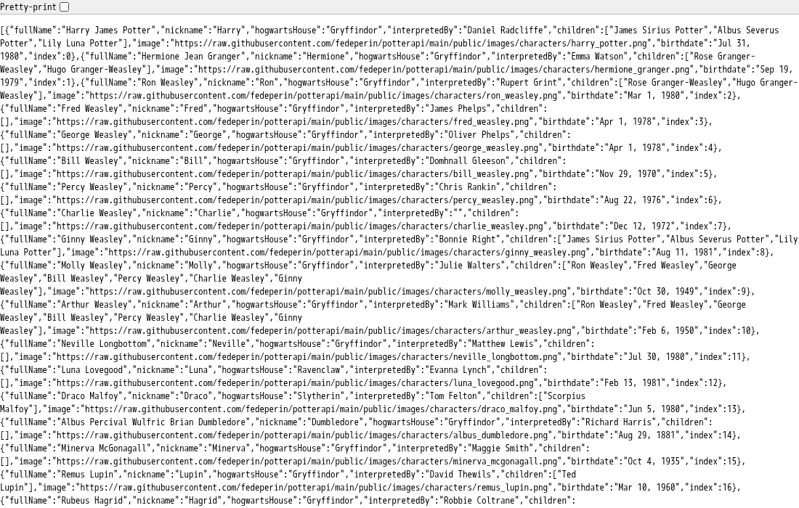
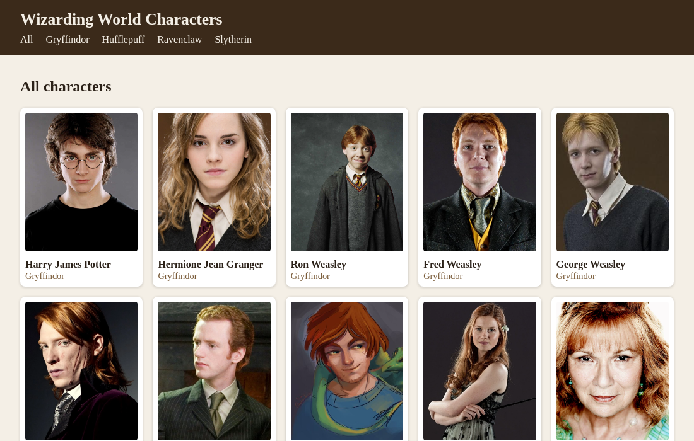
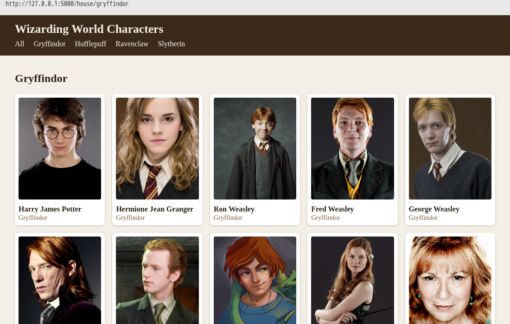
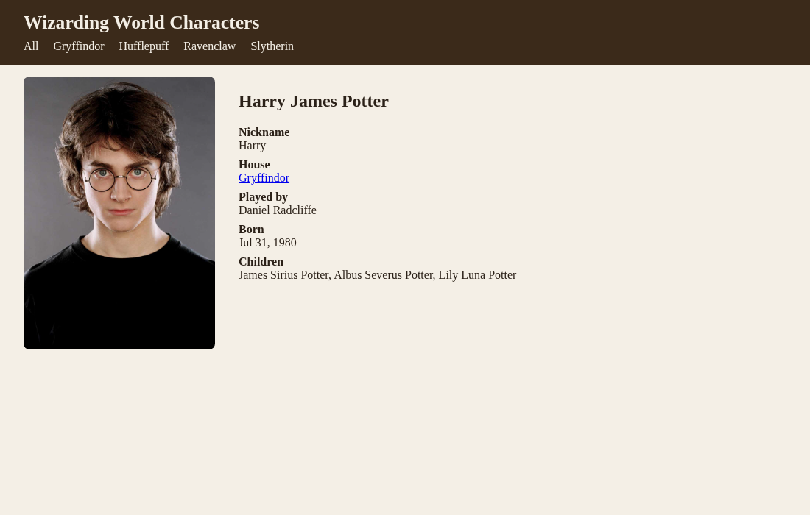
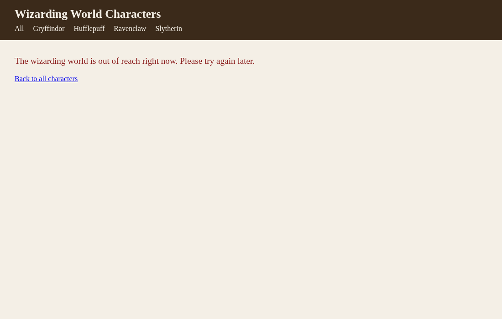

# 🚀 Harry Potter Website (Day 96)

A small Flask website that shows Harry Potter characters from a public REST API. It is the Day 96 assignment of the course *100 Days of Code: The Complete Python Pro Bootcamp*, written to be read, run and compared by other course participants.

## 📚 Table of Contents

- [Overview](#-overview)
- [Requirements](#-requirements)
- [Setup](#-setup)
- [Run](#-run)
- [Tests](#-tests)
- [License](#-license)
- [Links](#-links)
- [Appendix: Project documents](#-appendix-project-documents)

## 🧭 Overview

The site lists characters, filters them by Hogwarts house and shows one character. The code follows a layered layout and each part has one job:

| Folder | Purpose |
| --- | --- |
| `src/hp_site/domain/` | The `Character` entity and the errors |
| `src/hp_site/application/` | The `CharacterClient` port the website depends on |
| `src/hp_site/infrastructure/` | The HTTP client for the public API, using only the standard library |
| `src/hp_site/presentation/` | The Flask controller, templates and styles |
| `src/hp_site/constants.py` | Every shared constant |
| `tests/` | The pytest tests; they never call the network |
| `docs/` | Project documents, setup guide and screenshots |

### The lecture steps

**Step 1. Choose an API.** The lecture's Potter API is retired, so the site uses the [Potter API by fedeperin][api]. The choice is recorded in an [architecture decision][adr].



**Step 2. Make the first request and show the data.** The home page lists every character.



**Step 3. Filter by house.** `/house/<name>` lists one house, for example `/house/gryffindor`.



**Step 4. Show one character.** `/character/<id>` shows the details.



**Step 5. Handle a failing API.** When the service is down, the visitor sees a clear message and status 503.



The screenshots are taken with `bash tests/e2e/capture.sh`, which runs the site and a headless browser in Docker containers.

## 📋 Requirements

- Python 3.14 or newer, because `pyproject.toml` requires it.
- Flask is the only runtime dependency. The HTTP client uses the standard library.
- `pytest` for the tests (installed by the `dev` extra).
- Doxygen, only to build the API documentation.

## 🛠️ Setup

Create a local virtual environment, upgrade `pip` and install the project. On Windows (PowerShell):

```powershell
py -3.14 -m venv .venv
.\.venv\Scripts\Activate.ps1
python -m pip install --upgrade pip
python -m pip install -e ".[dev]"
```

On Linux and macOS:

```bash
python3.14 -m venv .venv
source .venv/bin/activate
python -m pip install --upgrade pip
python -m pip install -e ".[dev]"
```

More detail, including the checks to run before a push, is in the [setup guide][setup].

## ▶️ Run

```bash
python -m hp_site
```

Open <http://127.0.0.1:5000/>. Build the API documentation with `doxygen Doxyfile`; the output goes to `docs/doxygen/`.

## 🧪 Tests

```bash
python -m pytest
python -m ruff check src tests
python -m mypy src
```

## 📄 License

This project is released under the license in [LICENSE][license].

## 🔗 Links

- [Repository][repository]
- [Documentation][documentation]
- [Issue tracker][issues]
- [Wiki][wiki] in English, Danish and Bahasa Malaysia, with the lessons of each step and the reflection

## 📎 Appendix: Project documents

The documents a newcomer needs, in reading order. Drop a line only when the
project has no such document yet.

| Document | What it tells you |
| --- | --- |
| [Business Case][BC-001] | Why the project exists, its scope and success criteria |
| [Stakeholder Analysis][SA-001] | Who is involved; the stakeholder IDs used for owners and reviewers |
| [Project Plan][PP-001] | The gateways and their schedule |
| [Milestones][milestones] | One document per gateway: Go/No-Go criteria and tasks |
| [Artifact registry][registry] | Where each artifact type lives, the next version, the PO language and domain |
| [Framework README][framework-readme] | The framework this project uses |
| [Framework changelog][framework-changelog] | What changed in each framework release |

---

[repository]: https://git.tirsystem.com/Tirsvad-Udemy-100-days-of-code/096-assignment-custom-api-based-website
[documentation]: ./docs/setup.md
[issues]: https://git.tirsystem.com/Tirsvad-Udemy-100-days-of-code/096-assignment-custom-api-based-website/issues
[wiki]: https://git.tirsystem.com/Tirsvad-Udemy-100-days-of-code/096-assignment-custom-api-based-website/wiki
[setup]: ./docs/setup.md
[license]: ./LICENSE
[api]: https://potterapi-fedeperin.vercel.app/
[adr]: ./docs/adr/adr-0001-api-choice.md
[BC-001]: ./docs/business-case.md
[SA-001]: ./docs/stakeholder-analysis.md
[PP-001]: ./docs/project-plan.md
[milestones]: ./docs/milestones/
[registry]: ./docs/artifact-registry.md
[framework-readme]: ./framework/README.md
[framework-changelog]: ./framework/CHANGELOG.md
