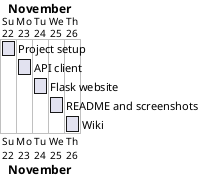

# Project Plan

## Metadata
| Key | Value |
| --- | --- |
| ID | PP-001 |
| CrossReference | [BC-001], [SA-001] |
| Language | en |
| Domain | it |

## Version History
| Date | Status | Author | Reviewer | Change | Commit |
| --- | --- | --- | --- | --- | --- |
| 2026-11-22 | Deprecated | Jens Tirsvad Nielsen | S01 | Initial version | [9ebd5b7] |
| 2026-11-22 | Accepted | Jens Tirsvad Nielsen | S01 | Accepted after review RC-003 (stand-in for S01, not independent) | [9ebd5b7] |

---

## Purpose

Schedule the five milestones that deliver the website, from setup to wiki, within one working session.

## Planning Assumptions

- Week 1 starts 2026-11-22; the plan ends by 2026-11-29, per the Business Case constraint (source: Business Case, Constraints).
- Phase length: about one day (source: Product Owner, S01).
- On a No-Go, the milestone is reworked and reviewed again; later milestones wait and the end date moves by the rework time, which S01 records in Open Issues.

## Gateway Schedule

| Gateway | Document | Window | Decision date | Owner | Stories | Main deliverable | Milestone |
| --- | --- | --- | --- | --- | --- | --- | --- |
| Project setup | [MIL-001] | 2026-11-22 | 2026-11-22 | S01 | none | Repository baseline and tooling | not yet synced |
| API client | [MIL-002] | 2026-11-23 | 2026-11-23 | S01 | none | Tested Harry Potter API client | not yet synced |
| Flask website | [MIL-003] | 2026-11-24 | 2026-11-24 | S01 | none | Running website | not yet synced |
| README and screenshots | [MIL-004] | 2026-11-25 | 2026-11-25 | S01 | none | README with run instructions and screenshots | not yet synced |
| Wiki | [MIL-005] | 2026-11-26 | 2026-11-26 | S01 | none | Wiki in en, da, ms and reflection | not yet synced |



## Scope Coverage

| Business Case scope item | Gateway |
| --- | --- |
| Repository description and topics, tooling, Doxygen | MIL-001 |
| API client and tests | MIL-002 |
| Flask website | MIL-003 |
| README and screenshots | MIL-004 |
| Wiki in three languages | MIL-005 |

## Dependencies

```
MIL-001 -> MIL-002 -> MIL-003 -> MIL-004 -> MIL-005
```

## Plan Risks

| Risk | Impact | Mitigation |
| --- | --- | --- |
| Public API offline | Screenshots and live checks fail | Fixture data and a clear error page |
| Docker unavailable for screenshots | No screenshots | Use a headless browser in a container; stop and report otherwise |

## Open Issues

- The API named in the lecture is retired; MIL-002 selects a maintained replacement and records it in an ADR.
- Screenshots and GUI checks run in a Docker container, never on the host desktop.

---

[BC-001]: ./business-case.md
[SA-001]: ./stakeholder-analysis.md
[9ebd5b7]: https://git.tirsystem.com/Tirsvad-Udemy-100-days-of-code/096-assignment-custom-api-based-website/commit/9ebd5b70bcdc84dd3c9c0717dfb3daa949a76ed5
